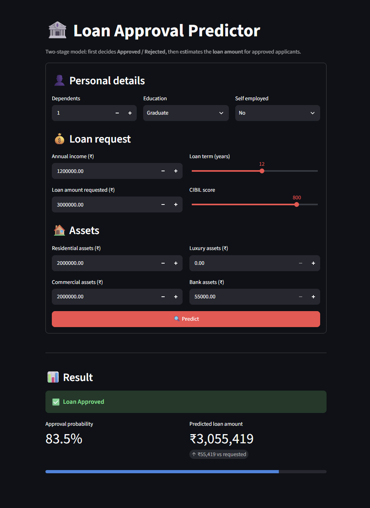
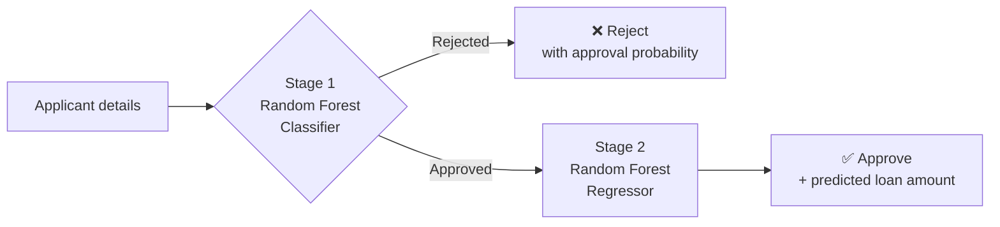

# 🏦 Two-Stage Loan Approval & Amount Predictor

**An end-to-end machine learning system that decides whether a loan should be approved and, if so, how much the applicant can be lent.**

[](https://two-stage-loan-approval-predictor.streamlit.app/)


👉 **Try it live:** https://two-stage-loan-approval-predictor.streamlit.app/



---

## 📌 Problem Statement

Banks and lending companies receive thousands of loan applications. Screening them manually is:

- **Slow** – applicants can wait days for a decision.
- **Inconsistent** – two loan officers can judge the same profile differently.
- **Incomplete** – a simple yes/no doesn't answer the next question a lender has: *how much is it safe to lend?*

A lender needs answers to **two separate questions** for every applicant:

1. **Should we approve this application?** → a *classification* problem
2. **If approved, what loan amount fits this applicant's profile?** → a *regression* problem

## 💡 Solution

A **two-stage ML pipeline** that mirrors how a real lender thinks:



**Why two stages instead of one model?**
The loan amount only makes sense for applicants who would actually get a loan. Stage 2 is therefore trained **only on approved applications**, so it learns what approved borrowers are lent — not noise from rejected ones. Stage 1 acts as a gate in front of it.

The models are served through:
- a **Streamlit web app** for interactive use, and
- a **command-line interface** (`main.py`) for quick checks.

---

## 📊 Dataset

- **4,269 loan applications** with 11 applicant features
- **Target:** `loan_status` – 2,656 Approved (62%) / 1,613 Rejected (38%)

| Type | Features |
|---|---|
| Personal | number of dependents, education, self-employed |
| Financial | annual income, loan amount, loan term (years), CIBIL score |
| Assets | residential, commercial, luxury and bank asset values |

---

## 🛠️ Approach

1. **Exploratory Data Analysis** – distributions, class balance, feature relationships
2. **Data cleaning** – removed stray whitespace in column names *and* category values, dropped the ID column
3. **Preprocessing pipeline** (scikit-learn `Pipeline` + `ColumnTransformer`)
   - Numerical: median imputation → standard scaling
   - Categorical: most-frequent imputation → one-hot encoding
4. **Stage 1 – Classification:** Random Forest tuned with `GridSearchCV` (5-fold CV, F1 scoring), stratified 80/20 split
5. **Stage 2 – Regression:** Random Forest Regressor tuned with `GridSearchCV` (5-fold CV, R² scoring), trained on approved applicants only
6. **Deployment** – both pipelines saved with `joblib`, served via Streamlit Community Cloud

---

## 📈 Results

### Stage 1 – Loan approval (test set, 854 applications)

| Metric | Score |
|---|---|
| Accuracy | **98.6%** |
| Precision | 99.1% |
| Recall | 98.7% |
| F1-score | 98.9% |
| ROC-AUC | 0.999 |

Only **12 of 854** test applications were misclassified (5 false approvals, 7 false rejections).

### Stage 2 – Loan amount (approved applicants)

| Metric | Score |
|---|---|
| R² | **0.86** |
| Mean absolute error | ₹25.1 lakh (on an average loan of ₹1.56 crore) |
| Median percentage error | ~15% |

---

## 🔍 Key Insights

- **CIBIL score is the deciding factor.** It accounts for **83%** of the classifier's feature importance.
  - 99.2% of rejected applicants had a CIBIL score below 550.
  - Applicants with a score of 550+ were approved 99.5% of the time; below 550, only 10%.
- **Income drives the loan amount.** Annual income accounts for **93%** of the regressor's importance (correlation with loan amount: 0.93).
- **Education and employment type barely matter** (< 1% importance) — decisions are driven by creditworthiness, not background.

---

## 🧩 Challenges & How I Solved Them

**1. Hidden whitespace silently disabled two features**
The raw data stored categories as `" Graduate"` and `" No"` (with a leading space). The models learned those values, while the app sent clean `"Graduate"` / `"No"`. Because the encoder ignores unknown categories, **education and self-employment were silently dropped from every prediction** — no error, no warning. Fixed by cleaning category values before training and retraining both models.

**2. A unit mismatch that the model couldn't detect**
`loan_term` is in **years** (2–20) in the data, but an early version of the CLI asked for months. Tree-based models don't fail on out-of-range input — they treat every value above 20 as 20, so a 5-year loan entered as "60" was scored as a 20-year loan. Fixed with input validation in the CLI and sliders limited to the training range in the web app.

**3. A useless feature in Stage 2**
The regressor was trained with `loan_status` as an input, but it's always "Approved" in its training data, so it carried no information. Removed it and made the prediction code pass only the columns each model was trained on.

**4. Deployment failures**
- Streamlit Cloud defaulted to Python 3.14, for which several pinned packages had no pre-built wheels, so the build hung trying to compile them from source. Fixed by pinning the runtime to **Python 3.12**.
- Removed an unused heavy dependency (`shap`) that blocked dependency resolution.
- Locally, Windows Smart App Control blocked the latest `pyarrow` binaries; pinned a compatible version.

---

## 📁 Project Structure

```
├── app/
│   ├── loader.py          # loads both model pipelines (paths from config.yaml)
│   ├── predict.py         # two-stage prediction logic
│   └── utils.py           # builds a clean input DataFrame from user input
├── data/
│   └── loan_approval_dataset.csv
├── models/
│   ├── stage_1_rf_classifier_pipeline.pkl
│   └── stage_2_rf_regression_pipeline.pkl
├── notebooks/
│   └── analyze.ipynb      # EDA, training, tuning and evaluation
├── config.yaml            # model paths + default UI inputs
├── main.py                # command-line app
├── streamlit_app.py       # web app
└── requirements.txt
```

---

## 🚀 Run Locally

Requires **Python 3.12** and [uv](https://docs.astral.sh/uv/).

```bash
git clone https://github.com/tushar-dudeja-2001/Two-Stage-Loan-Approval-Predictor.git
cd Two-Stage-Loan-Approval-Predictor
uv venv
uv pip install -r requirements.txt
```

**Web app:**
```bash
uv run streamlit run streamlit_app.py
```

**Command line:**
```bash
uv run python main.py
```

**Retrain the models:** run `notebooks/analyze.ipynb` top to bottom — it saves new pipelines to `models/`.

> **Note:** the models were trained with scikit-learn 1.7.1. Use the versions in `requirements.txt` so the saved pipelines load correctly.

---

## ⚠️ Limitations

- Trained on a single dataset of 4,269 applications; real-world lending data is larger and messier.
- The model relies very heavily on CIBIL score, so it may not generalise to applicants without a credit history.
- Stage 2 predicts the loan amount approved *in this dataset*, not a risk-adjusted maximum the applicant can afford.

## 🔮 Future Improvements

- Add **SHAP explanations** so each applicant sees *why* they were approved or rejected
- Compare against **XGBoost / LightGBM** and logistic regression baselines
- Add unit tests and a CI pipeline
- Expose the model through a **FastAPI** endpoint

---

## 🧰 Tech Stack

Python · pandas · NumPy · scikit-learn · Matplotlib · Seaborn · Streamlit · joblib · uv

## 👤 Author

**Tushar Dudeja**
GitHub: [@tushar-dudeja-2001](https://github.com/tushar-dudeja-2001)
<!-- Add your LinkedIn: [LinkedIn](https://www.linkedin.com/in/your-profile) -->
